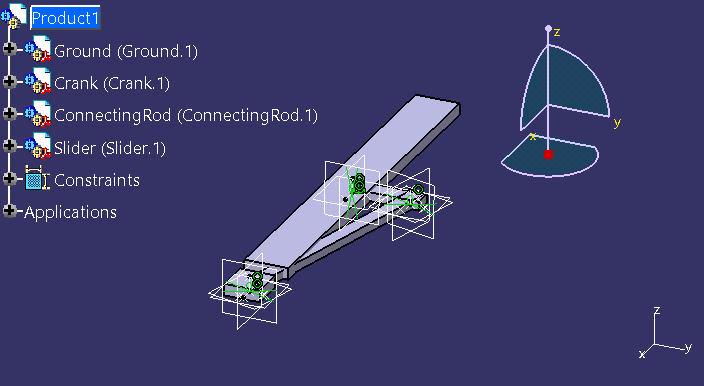
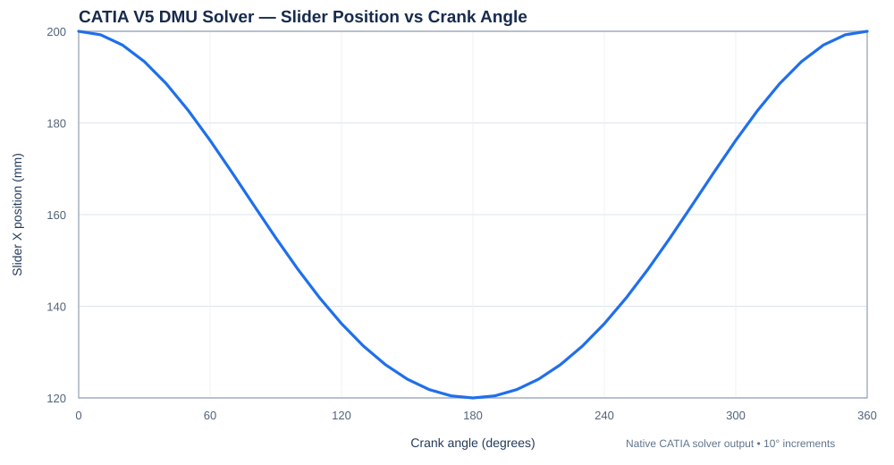

# Task 3 — CATIA V5 Structural and Motion Simulation

## Slider-crank motion study using the native DMU Kinematics solver

**Software:** CATIA V5 R21, DMU Kinematics. **Analysis type:** rigid-body kinematics. **Units:** mm and degrees.

## Model and constraints

The native CATIA assembly contains a fixed ground, a 40 mm crank, a 160 mm center-to-center connecting rod, and a guided slider. The mechanism uses three revolute joints and one prismatic joint. The ground is fixed, and one angle command drives the ground-to-crank revolute joint. CATIA reports one remaining degree of freedom after the four joints are added.

The solver swept the crank through 0°–360° in 10° increments. For each commanded angle, the macro called CATIA's native mechanism solver and retrieved the slider's 12-value product motion transform. The slider's global X translation is column `matrix_9` in the CSV.

## Results

| Crank angle | Slider X position |
|---:|---:|
| 0° | 200.000 mm |
| 90° | 154.919 mm |
| 180° | 120.000 mm |
| 270° | 154.919 mm |
| 360° | 200.000 mm |

The computed travel is **80.000 mm** (120–200 mm). An independent geometric relation, `x = r cos(theta) + sqrt(L^2 - r^2 sin^2(theta))`, was used only as a check; the maximum difference from the CATIA solver output across the 37 saved points is approximately **3.3 × 10⁻¹⁰ mm**.

## Observations and scope

- Slider displacement is periodic over one crank revolution and reaches dead-center positions at 0°/360° and 180°.
- The finite connecting-rod length causes unequal slider travel on each half of the crank rotation.
- The native CATIA result is a kinematic position sweep. This run does not calculate stress, inertia forces, torque, contact, friction, or flexible-body effects.

## Files

- `SliderCrank_CATIA_DMU_Solver.CATProduct` — native CATIA assembly and mechanism. Keep the four companion CATPart files beside it.
- `Ground_CATIA.CATPart`, `Crank_CATIA.CATPart`, `ConnectingRod_CATIA.CATPart`, `Slider_CATIA.CATPart` — native component geometry and joint references.
- `catia_dmu_slider_crank_motion.csv` — the 37 CATIA-solver transforms.
- `CATIA_Solver_Slider_Position.svg` — plot derived from the solver CSV.
- `catia_dmu_slider_crank.jpg` — CATIA viewport screenshot of the assembly.
- `task3_native_solver.CATScript` and `task3_native_solver.log` — replay macro and its recorded solver status.

## Opening in CATIA V5

Download all files from this folder (or the ZIP package), extract them together, and open `SliderCrank_CATIA_DMU_Solver.CATProduct` in CATIA V5. Keep the four `.CATPart` files in the same directory so CATIA can resolve the product links. A CATIA V5 installation with DMU Kinematics is needed to inspect or rerun the mechanism.
