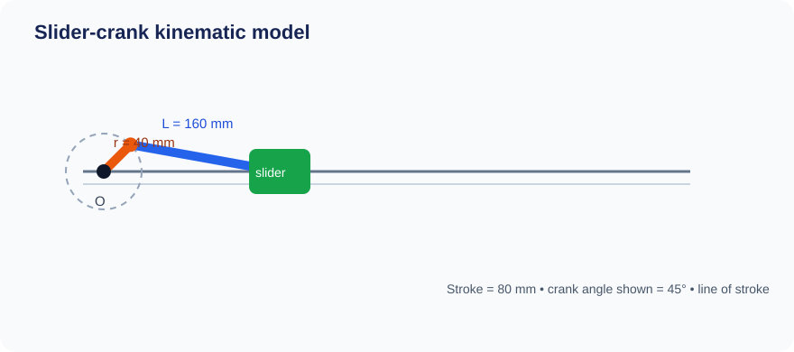

# Task 3 — Slider-Crank Motion Simulation

A single slider-crank mechanism is simulated through one crank revolution. This repository contains a browser animation, a short report, motion data, plots, and the source that regenerates the numeric results.

## Open the submission

- [Motion simulation and animation](motion_simulation.html)
- [Short report](report.html)
- [Motion results CSV](motion_results.csv)
- [Complete submission package (ZIP)](task3_slider_crank_submission.zip)

## Model

Crank radius: 40 mm • Connecting rod: 160 mm • Slider mass: 0.50 kg • Constant crank speed: 600 rpm • Stroke: 80 mm.

The calculations use exact planar slider-crank kinematics and include slider inertia only. The report covers displacement, velocity, acceleration, drive force, connecting-rod axial force, and ideal crank input torque. Link masses, friction, joint clearance, flexibility, and external load are excluded.

The interactive simulation runs locally in a modern browser. GitHub displays the source for the HTML file; download it or clone the repository to run it. The results are analytical model output and are not represented as CATIA DMU Kinematics solver results.

## Files

- slider_crank_sim.js — Node.js generator for data, summary, report, and plots.
- motion_results.csv — complete-cycle results at 5° increments.
- summary.json — model inputs and extrema.
- slider_crank_model.svg and *_graph.svg — overview and motion plots.
- motion_simulation.html — animated linkage with adjustable angle/speed and live charts.
- report.html — brief method, results, observations, and limitations.

