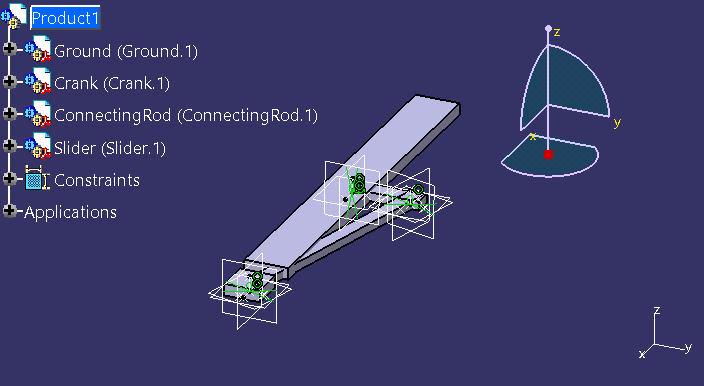

# Task 3 — CATIA V5 Motion Simulation

## Native CATIA solver submission

This project contains a slider-crank mechanism created and solved in CATIA V5 R21 DMU Kinematics.

- [Open the Task 3 report](CATIA_V5_DMU_Solver/CATIA_V5_DMU_Motion_Report.md)
- [View the report page](CATIA_V5_DMU_Solver/index.html)
- [Download all CATIA model and evidence files](CATIA_V5_DMU_Solver_Package.zip)
- [Browse the CATIA solver files](CATIA_V5_DMU_Solver/)

The CATIA mechanism has a fixed ground, three revolute joints, one prismatic joint, one crank-angle command, and one degree of freedom. The native solver completed 37 positions over a full 360° crank cycle. The calculated slider travel is 80 mm.

## Existing analytical companion

The root-level browser animation and its force/velocity plots are an analytical companion model. They remain separate from the native CATIA solver results. The native CATIA results and their scope are documented in the report above.

## Opening the CATIA file

Download the ZIP package, extract the contents together, and open `SliderCrank_CATIA_DMU_Solver.CATProduct` in CATIA V5. Keep all four companion `.CATPart` files beside the product file so CATIA can resolve the assembly links. DMU Kinematics is required to inspect or rerun the mechanism.
